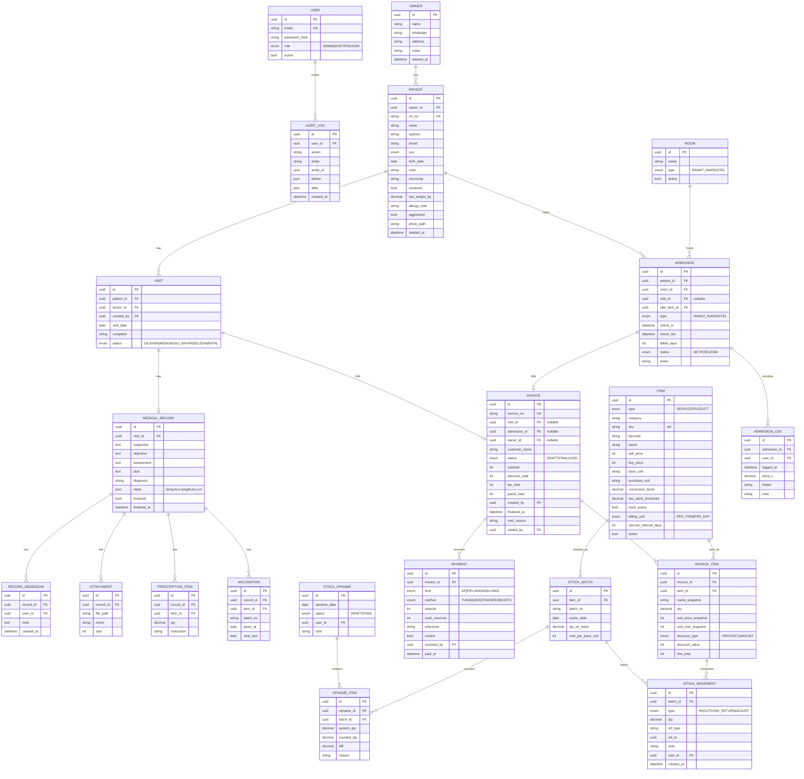
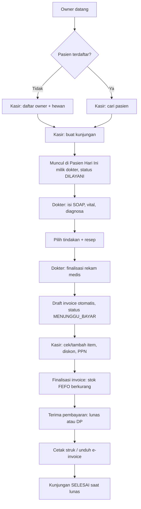
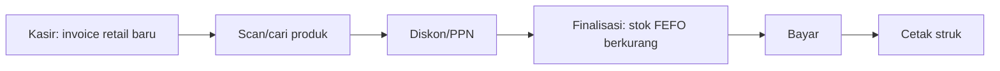
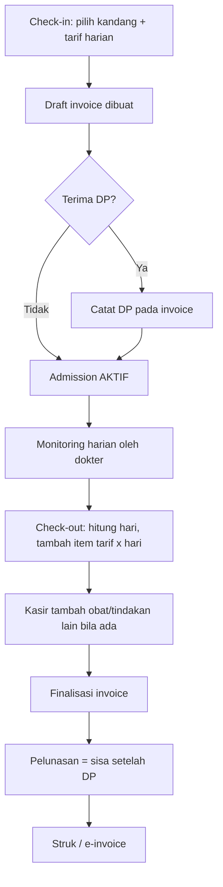
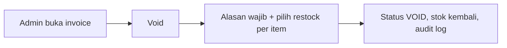
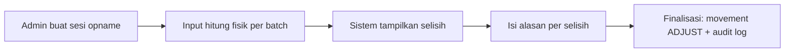

# Sistem POS + PMS Klinik Hewan: Spesifikasi Teknis (v2, 2 Fase)

> Dokumen ini adalah sumber kebenaran teknis untuk coding agent. Scope dan prioritas mengikuti `docs/PRD.md`. Kalau ada konflik teknis antara dokumen ini dan asumsi agent, **dokumen ini menang**. Kalau ada hal yang belum jelas, **tanyakan, jangan menebak**.

---

## 1. Konteks

| Item | Isi |
|---|---|
| Jenis | Aplikasi gabungan **kasir (POS)** dan **rekam medis (PMS)** untuk klinik hewan |
| Klien | 1 klinik nyata (single-tenant) |
| User | 3 akun: Owner/Admin, Dokter, Kasir |
| Volume | ±20 pasien/hari. Performa bukan isu, **integritas data** adalah prioritas |
| Layanan | Konsultasi, vaksin, operasi/tindakan, rawat inap, grooming, pet hotel, pet shop |
| Bahasa & mata uang | UI Bahasa Indonesia, IDR |
| Hardware | Printer thermal (58/80mm), PC/tablet kasir |
| Desain | Profesional, bersih, tidak berlebihan. Warna teal/biru |

## 2. Keputusan Teknis (Final)

| Area | Keputusan |
|---|---|
| Platform | Web app responsif (PC + tablet), online, tanpa offline |
| Framework | Next.js (App Router) + TypeScript |
| Database | PostgreSQL |
| ORM | Prisma |
| Auth | Auth.js (Credentials: email + password), session cookie |
| UI | Tailwind CSS + shadcn/ui |
| Validasi | Zod (client dan server) |
| Test | Vitest untuk logika bisnis |
| PDF (e-invoice) | `@react-pdf/renderer` di route server (hindari Puppeteer agar container ringan) |
| Deploy | VPS Indonesia + Docker Compose, reverse proxy HTTPS (Caddy/Nginx) |
| Backup | `pg_dump` harian otomatis ke storage terpisah, retensi 14 hari, termasuk folder lampiran |
| Zona waktu | `Asia/Jakarta` untuk tampilan, simpan UTC di DB |
| Uang | **Integer Rupiah** (tanpa desimal, tanpa float) |
| Cetak struk | `window.print()` + CSS `@page` 80mm (58mm via setting). Upgrade ke QZ Tray hanya jika dialog print mengganggu |
| QRIS | Statis: tampilkan gambar QR dari Settings, kasir konfirmasi manual |

---

## 3. Pembagian Fase

| Fase | Isi |
|---|---|
| **1 (MVP)** | Seluruh operasional: pasien, kunjungan, rekam medis, rawat inap/hotel, inventaris (termasuk opname), kasir (diskon, PPN, DP), struk thermal, e-invoice PDF, dashboard dasar, audit log, backup |
| **2** | Import data lama, laporan lengkap + export PDF/Excel, dashboard lanjut, tutup kas harian |

**Milestone internal Fase 1:** 1A (inti) → 1B (rawat inap/hotel, DP, e-invoice, opname, notifikasi) → 1C (dashboard, audit, backup, uji e2e).

**Aturan fase:** jangan membangun fitur di luar fase yang sedang dikerjakan. Tabel Fase 2 (`import_jobs`, `cash_closings`) **tidak** dibuat di Fase 1.

## 4. Di Luar Scope (jangan dibangun)

Antrean/nomor antrean, booking, refund, bundling/paket, cicilan, supplier & PO, WhatsApp (API maupun `wa.me`), kartu vaksin & surat sehat, QRIS dinamis/payment gateway, PIN kasir, multi-cabang/tenant, mode offline, portal pemilik, integrasi akuntansi, komisi dokter, obat racikan/dosis per berat, multi-gudang.

---

## 5. Role & Hak Akses

| Fitur | Owner/Admin | Dokter | Kasir |
|---|:-:|:-:|:-:|
| Kelola user, pengaturan klinik | ✅ | ❌ | ❌ |
| Master layanan & harga jual | ✅ | ❌ | 👁 lihat |
| Master produk, **harga beli**, margin | ✅ | ❌ | ❌ |
| Daftar owner & pasien | ✅ | ✅ | ✅ |
| Input kunjungan (walk-in) | ✅ | ✅ | ✅ |
| Isi & finalisasi rekam medis, resep | ✅ | ✅ | ❌ |
| Lihat rekam medis | ✅ | ✅ | ❌ (hanya alert alergi/agresif) |
| Check-in/out rawat inap & hotel | ✅ | ✅ | ✅ |
| Monitoring harian rawat inap | ✅ | ✅ | ❌ |
| Master kandang/ruangan | ✅ | ❌ | ❌ |
| Invoice, pembayaran, DP | ✅ | ❌ | ✅ |
| Diskon | ✅ | ❌ | ✅ (tercatat audit) |
| Void invoice | ✅ | ❌ | ❌ |
| Stok masuk, stok opname | ✅ | ❌ | ❌ |
| Omzet & laporan total (dashboard/laporan) | ✅ | ❌ | ❌ |
| Audit log | ✅ | ❌ | ❌ |

---

## 6. Kebutuhan Fungsional

Kolom F = fase. Semua F1 kecuali disebut.

### 6.1 Auth & User
| ID | Kebutuhan | F |
|---|---|:-:|
| FR-AUTH-1 | Login email + password, logout, session timeout 12 jam, rate limit login | 1 |
| FR-AUTH-2 | Admin CRUD user (nama, email, role, aktif/nonaktif). Tanpa hard delete | 1 |
| FR-AUTH-3 | Ganti password sendiri | 1 |

### 6.2 Owner & Pasien
| ID | Kebutuhan | F |
|---|---|:-:|
| FR-PAT-1 | CRUD **Owner**: nama (wajib), WhatsApp (wajib, normalisasi `62xxx`), alamat (wajib), catatan | 1 |
| FR-PAT-2 | CRUD **Pasien**: nama, spesies, ras, jenis kelamin, tgl lahir (atau perkiraan umur), warna, microchip, status steril, berat terakhir. Foto opsional | 1 |
| FR-PAT-3 | 1 owner banyak pasien. Pasien wajib terhubung ke 1 owner | 1 |
| FR-PAT-4 | Nomor RM otomatis: `RM-YYYY-NNNNN` (urut, reset per tahun) | 1 |
| FR-PAT-5 | **Alert alergi / agresif**: banner merah di profil, daftar hari ini, form rekam medis, form resep | 1 |
| FR-PAT-6 | Pencarian cepat: nama owner, nama hewan, no. WA, no. RM, microchip | 1 |
| FR-PAT-7 | Profil pasien: riwayat kunjungan, vaksinasi, rawat inap, berat | 1 |
| FR-PAT-8 | Soft delete + peringatan duplikat (no. WA sama) | 1 |

### 6.3 Kunjungan (tanpa antrean)
| ID | Kebutuhan | F |
|---|---|:-:|
| FR-VIS-1 | Kasir/Admin/Dokter membuat kunjungan walk-in: pilih pasien, dokter, keluhan. **Tidak ada nomor antrean** | 1 |
| FR-VIS-2 | Status: `DILAYANI → MENUNGGU_BAYAR → SELESAI` (+ `BATAL`). `MENUNGGU_BAYAR` otomatis saat dokter finalisasi rekam medis. `SELESAI` otomatis saat invoice lunas | 1 |
| FR-VIS-3 | Halaman "Pasien Hari Ini" untuk dokter: daftar kunjungan hari ini, urut waktu masuk, auto-refresh 10 detik | 1 |

### 6.4 Rekam Medis
| ID | Kebutuhan | F |
|---|---|:-:|
| FR-MR-1 | Satu rekam medis per kunjungan, format **SOAP**, teks bebas | 1 |
| FR-MR-2 | **Vital signs**: suhu (°C), HR (bpm), RR (/menit), berat (kg), BCS (1-9), CRT (detik). Berat memperbarui profil pasien | 1 |
| FR-MR-3 | **Diagnosa**: free text + autocomplete master diagnosa (dokter bisa menambah master dari form) | 1 |
| FR-MR-4 | **Tindakan** dipilih dari master layanan, masuk draft invoice | 1 |
| FR-MR-5 | **Resep/obat**: produk, jumlah, aturan pakai (teks). Masuk draft invoice. Stok **belum** berkurang (BR-4) | 1 |
| FR-MR-6 | **Finalisasi** mengunci rekam medis. Koreksi hanya lewat **addendum** (catatan tambahan bertanda waktu + user). Isi asli tidak pernah diubah | 1 |
| FR-MR-7 | Lampiran hasil lab/rontgen: PDF/JPG/PNG, maks 10 MB, disimpan di volume disk, dilayani lewat route ber-auth | 1 |
| FR-MR-8 | Vaksinasi: vaksin, tgl pemberian, batch, **tgl jatuh tempo berikutnya** (default dari `vaccine_interval_days`, bisa diubah) | 1 |
| FR-MR-9 | Halaman "Jatuh Tempo": pasien dengan vaksin/kontrol jatuh tempo dalam N hari (default 14). **Hanya tampilan**, tanpa tombol WhatsApp | 1 |

### 6.5 Master Layanan & Produk
| ID | Kebutuhan | F |
|---|---|:-:|
| FR-MST-1 | Satu tabel `items` dengan `type` `SERVICE`/`PRODUCT`. Kategori: konsultasi, tindakan, operasi, rawat inap, hotel, grooming, obat, vaksin, pet food, aksesoris, consumable | 1 |
| FR-MST-2 | Harga jual tetap per item, hanya Admin yang mengubah. Perubahan tidak memengaruhi invoice lama (snapshot) | 1 |
| FR-MST-3 | Produk: SKU, barcode (opsional), harga beli, harga jual, satuan dasar, satuan beli + faktor konversi, threshold stok rendah, flag `track_expiry` | 1 |
| FR-MST-4 | Layanan bertarif harian (`billing_unit = PER_DAY`) untuk rawat inap dan hotel | 1 |
| FR-MST-5 | Master kandang/ruangan (`rooms`): nama, jenis (rawat inap/hotel), aktif | 1 |

### 6.6 Rawat Inap & Pet Hotel
| ID | Kebutuhan | F |
|---|---|:-:|
| FR-ADM-1 | Check-in: pilih pasien, jenis (`RAWAT_INAP`/`HOTEL`), kandang, tanggal-jam masuk, item tarif harian. Rawat inap dapat dikaitkan ke kunjungan | 1 |
| FR-ADM-2 | Satu kandang tidak boleh dipakai dua admission aktif sekaligus | 1 |
| FR-ADM-3 | Monitoring harian rawat inap (`admission_logs`): waktu, suhu (opsional), makan/minum, catatan. Oleh Dokter/Admin | 1 |
| FR-ADM-4 | Check-out: sistem menghitung jumlah hari (BR-15) dan menambahkan item `tarif × hari` ke draft invoice terkait (membuat invoice jika belum ada) | 1 |
| FR-ADM-5 | Layar admission aktif (siapa, di kandang mana, sudah berapa hari) | 1 |
| FR-ADM-6 | Grooming diperlakukan sebagai layanan biasa di kasir, tanpa modul khusus | 1 |

### 6.7 Inventaris
| ID | Kebutuhan | F |
|---|---|:-:|
| FR-INV-1 | Stok per **batch**: `batch_no`, `expiry_date`, `qty_on_hand`, `cost_per_base_unit` | 1 (1A) |
| FR-INV-2 | **Stok masuk manual** (Admin): produk, jumlah (satuan beli), batch, expiry, harga beli, catatan teks bebas (mis. nama pemasok). Dikonversi ke satuan dasar. **Tanpa** tabel supplier/PO | 1 (1A) |
| FR-INV-3 | Pengurangan stok otomatis **FEFO**, bisa lintas batch | 1 (1A) |
| FR-INV-4 | **Blokir penjualan batch expired.** Tidak ada override | 1 (1A) |
| FR-INV-5 | Kartu stok (`stock_movements`): masuk, keluar, void, penyesuaian, dengan referensi dokumen dan user | 1 (1A) |
| FR-INV-6 | **Stok opname** (Admin): buat sesi opname, input hitung fisik per batch, sistem menampilkan selisih, finalisasi membuat movement `ADJUST` dengan alasan wajib | 1 (1B) |
| FR-INV-7 | **Notifikasi dashboard**: stok di bawah threshold, batch hampir expired (default 90 hari, diatur di Settings) | 1 (1B) |

### 6.8 Kasir & Billing
| ID | Kebutuhan | F |
|---|---|:-:|
| FR-POS-1 | Invoice **auto** dari kunjungan (tindakan + resep) dan bisa ditambah/ubah manual sebelum finalisasi | 1 |
| FR-POS-2 | Invoice **retail walk-in** tanpa pasien/kunjungan. Customer opsional | 1 |
| FR-POS-3 | Jasa + produk dalam 1 invoice. Scan barcode untuk produk | 1 |
| FR-POS-4 | **Diskon** per item dan per invoice, % atau nominal. Tercatat di audit log | 1 |
| FR-POS-5 | **PPN** di Settings: on/off, persentase (default 11%), mode include/exclude | 1 |
| FR-POS-6 | Metode bayar: Tunai, QRIS (statis), Transfer, Kartu debit/kredit | 1 |
| FR-POS-7 | Tunai: input uang diterima, hitung kembalian | 1 |
| FR-POS-8 | **DP + pelunasan** sesuai BR-9 (maks 2 pembayaran per invoice, tanpa cicilan) | 1 (1B) |
| FR-POS-9 | **Void invoice** (Admin, alasan wajib, restock per item). **Bukan refund** (BR-13) | 1 |
| FR-POS-10 | **Struk thermal**: nama klinik, alamat, no. invoice, tanggal, kasir, item, diskon, PPN, total, DP, sisa, metode bayar, kembalian. Header/footer dari Settings | 1 |
| FR-POS-11 | Cetak ulang struk (ditandai "SALINAN") | 1 |
| FR-POS-12 | **E-invoice PDF** (BR-16): tombol unduh di halaman invoice. Dikirim manual oleh staf | 1 (1B) |
| FR-POS-13 | Tutup kas harian: modal awal, hitung fisik, selisih terhadap total tunai sistem | 2 |

### 6.9 Dashboard, Laporan, Sistem
| ID | Kebutuhan | F |
|---|---|:-:|
| FR-RPT-1 | **Dashboard dasar**: omzet hari ini (**Admin saja**), jumlah kunjungan hari ini, admission aktif, notifikasi stok (FR-INV-7). Kasir/Dokter tidak melihat angka omzet | 1 |
| FR-RPT-2 | Laporan: omzet harian/bulanan, **laba kotor** (penjualan − HPP dari snapshot), top produk/layanan, stok menipis, expired, kunjungan, jatuh tempo kontrol | 2 |
| FR-RPT-3 | Export PDF dan Excel (.xlsx) | 2 |
| FR-RPT-4 | Dashboard lanjut (grafik tren) | 2 |
| FR-SYS-1 | **Audit log**: siapa, kapan, aksi, entitas, nilai sebelum/sesudah. Untuk: harga, stok (masuk/opname), void, diskon, DP (termasuk koreksi), finalisasi/addendum rekam medis, user, settings | 1 |
| FR-SYS-2 | Settings klinik: nama, alamat, telepon, NPWP, logo, footer struk, PPN, lebar kertas, gambar QRIS, hari peringatan expired | 1 |
| FR-SYS-3 | Backup harian otomatis (script + cron di VPS) + dokumentasi restore | 1 |
| FR-SYS-4 | **Import data lama** (CSV/Excel): owner, pasien, stok (+batch). Alur: unggah → pemetaan kolom → **preview + validasi** → konfirmasi. Tidak ada data tersimpan sebelum konfirmasi. Laporan baris gagal bisa diunduh | 2 |

---

## 7. Aturan Bisnis Kritis

| ID | Aturan |
|---|---|
| BR-1 | Semua uang **integer Rupiah**. Dilarang `float`. PPN dihitung di level invoice dan dibulatkan ke Rupiah terdekat |
| BR-2 | Rekam medis final **tidak boleh diedit atau dihapus**. Hanya addendum |
| BR-3 | Data transaksional (invoice, pembayaran, stock movement, rekam medis, audit log) **tidak pernah di-hard-delete**. Master data pakai soft delete |
| BR-4 | **Stok berkurang saat invoice difinalisasi** (`status` `DRAFT → FINAL`), bukan saat resep ditulis. Void mengembalikan stok sesuai pilihan |
| BR-5 | Alokasi **FEFO**. Batch expired tidak boleh dialokasikan. Jika stok tidak cukup, finalisasi ditolak dengan pesan jelas |
| BR-6 | Invoice menyimpan **snapshot** nama, harga jual, dan harga beli (HPP) per item saat transaksi |
| BR-7 | Kasir **tidak boleh** melihat harga beli, margin, omzet, atau laporan total, baik di UI maupun **response API** |
| BR-8 | Stok disimpan di **satuan dasar** terkecil (ml, tablet, pcs, gram). Pembelian dikonversi dengan faktor di master |
| BR-9 | **Pembayaran:** invoice punya `status` dokumen (`DRAFT`, `FINAL`, `VOID`) dan `payment_status` turunan (`BELUM_BAYAR`, `SEBAGIAN`, `LUNAS`). Maksimal **2 pembayaran** per invoice: (a) 1 pembayaran lunas, atau (b) 1 DP (sebagian) lalu 1 pelunasan yang **harus sama dengan sisa**. Tanpa cicilan. DP boleh diterima pada invoice `DRAFT` maupun `FINAL`. Finalisasi ditolak jika total DP > grand total. Overpay hanya untuk tunai (kembalian). Jumlah DP hanya bisa dikoreksi Admin, tercatat di audit log |
| BR-10 | Nomor invoice `INV-YYYYMMDD-NNN` (urut harian), tidak dipakai ulang, termasuk invoice void |
| BR-11 | Semua endpoint/server action wajib cek **role di server** |
| BR-12 | Satu tindakan = satu transaksi DB (invoice + stock movement + payment atomik, Prisma `$transaction`) |
| BR-13 | **Void ≠ refund.** Void hanya Admin, wajib alasan, berlaku untuk invoice `DRAFT`/`FINAL`. Pembayaran yang sudah masuk tetap tercatat dan diberi tanda void. Pengembalian uang (jika ada) dilakukan di luar sistem dan dicatat di kolom alasan. Void mengembalikan stok sesuai pilihan restock per item |
| BR-14 | Invoice `FINAL` tidak bisa diubah item/harganya. Koreksi = void + buat invoice baru. Yang boleh setelah `FINAL`: menerima pelunasan |
| BR-15 | **Hitung hari menginap (default, menunggu konfirmasi klien):** jumlah hari = selisih tanggal kalender (check-out − check-in), **minimal 1**. Dihitung sekali saat check-out dan bisa dilihat sebelum finalisasi |
| BR-16 | E-invoice adalah **dokumen invoice digital (PDF)**, bukan faktur pajak. Berisi data klinik, owner, pasien, item, diskon, PPN, total, DP, sisa, status bayar |
| BR-17 | Satu kandang hanya untuk satu admission aktif |

---

## 8. Model Data (ERD)



**Catatan skema**
- `payment_status` **diturunkan** dari jumlah `payments` non-void dibanding `grand_total`, tidak disimpan sebagai sumber kebenaran (boleh di-cache).
- Tabel pendukung lain: `settings` (key-value), `diagnosis_master`.
- Constraint: `qty_on_hand >= 0`; maksimal 2 `payments` non-void per invoice (validasi aplikasi + test); satu admission `AKTIF` per `room_id` (partial unique index).
- Index wajib: `patient.rm_no`, `owner.whatsapp`, `patient.microchip`, `invoice.invoice_no`, `stock_batch(item_id, expiry_date)`, `visit(visit_date, status)`, `admission(room_id, status)`.
- Fase 2 menambah: `import_jobs` (+ log baris), `cash_closings`.

---

## 9. User Flow

### 9.1 Kunjungan Walk-in (tanpa antrean)



### 9.2 Retail Walk-in



### 9.3 Rawat Inap / Pet Hotel dengan DP



### 9.4 Void Invoice



### 9.5 Stok Opname



---

## 10. Non-Functional

| Area | Kebutuhan |
|---|---|
| Keamanan | Password hash argon2/bcrypt, cookie `httpOnly` + `secure`, rate limit login, validasi Zod semua input, otorisasi di server |
| Privasi | Data owner hanya untuk user terautentikasi. Lampiran tidak publik |
| Integritas | Transaksi DB untuk invoice/stok/pembayaran. Constraint DB untuk stok non-negatif |
| UX | Tablet-friendly (target sentuh ≥ 44px), alur kasir maksimal 3 klik dari invoice ke bayar, pesan error Bahasa Indonesia |
| Aksesibilitas | Kontras cukup, fokus keyboard jelas, scan barcode via input fokus |
| Observabilitas | Log error terstruktur, health-check endpoint |
| Test | Unit test wajib: FEFO, konversi satuan, diskon/PPN/pembulatan, aturan DP (maks 2 pembayaran, pelunasan = sisa), status invoice, void & restock, hitung hari menginap, opname, permission matrix, **kasir tidak menerima field harga beli** |
| Lokalisasi | Format tanggal `DD MMM YYYY`, uang `Rp 1.250.000`, zona `Asia/Jakarta` |

---

## 11. Task Breakdown

### Fase 1, Milestone 1A: Inti
| # | Task | Acceptance Criteria (ringkas) |
|---|---|---|
| 1A.1 | Setup proyek: Next.js, TS, Prisma, Postgres (Docker Compose), Tailwind, shadcn, lint, Vitest | `docker compose up` jalan, migrasi & seed berjalan |
| 1A.2 | Skema Prisma + migrasi + seed (3 user, contoh item, contoh pasien) | Sesuai bagian 8 |
| 1A.3 | Auth + role guard (server-side) + layout per role | Matriks bagian 5 lolos tes |
| 1A.4 | Settings klinik + util audit log | Perubahan harga/stok/settings tercatat |
| 1A.5 | Master item (layanan & produk), kategori, konversi satuan, master kandang | Kasir tidak menerima `buy_price` di response |
| 1A.6 | Owner & pasien: CRUD, pencarian, nomor RM, alert alergi/agresif | Banner tampil di semua halaman terkait |
| 1A.7 | Kunjungan walk-in + halaman "Pasien Hari Ini" | Tanpa nomor antrean, status berpindah sesuai FR-VIS-2 |
| 1A.8 | Rekam medis: SOAP, vital, diagnosa, lampiran, vaksinasi, finalisasi, addendum, halaman jatuh tempo | Final mengunci, addendum berfungsi |
| 1A.9 | Resep & tindakan → draft invoice otomatis | Item dokter muncul di invoice |
| 1A.10 | Inventaris dasar: stok masuk manual, batch, kartu stok, FEFO, blokir expired | Unit test FEFO lintas batch & konversi |
| 1A.11 | Kasir: invoice auto/manual/retail, diskon, PPN, pembayaran penuh, kembalian, finalisasi | Unit test total & pembulatan |
| 1A.12 | Void invoice (Admin) + restock | Stok & audit konsisten |
| 1A.13 | Struk thermal 80mm (+58mm via setting) | Cetak rapi lewat `window.print()` |

### Fase 1, Milestone 1B: Layanan Lanjutan & Dokumen
| # | Task | Acceptance Criteria (ringkas) |
|---|---|---|
| 1B.1 | Rawat inap & hotel: check-in, kandang tunggal, layar admission aktif | Kandang terisi tidak bisa dipakai ganda |
| 1B.2 | Monitoring harian rawat inap | Log tersimpan, tampil di profil pasien |
| 1B.3 | Check-out + hitung hari (BR-15) + item tarif ke invoice | Unit test hitung hari termasuk kasus 0 hari → 1 |
| 1B.4 | DP + pelunasan (BR-9) | Unit test: maks 2 pembayaran, pelunasan = sisa, DP > total ditolak, koreksi DP oleh Admin tercatat audit |
| 1B.5 | E-invoice PDF | Terunduh dari halaman invoice, isi sesuai BR-16 |
| 1B.6 | Stok opname | Selisih membuat movement `ADJUST`, alasan wajib |
| 1B.7 | Notifikasi stok rendah/hampir expired di dashboard | Threshold dan hari peringatan dari Settings |

### Fase 1, Milestone 1C: Penutup
| # | Task | Acceptance Criteria (ringkas) |
|---|---|---|
| 1C.1 | Dashboard dasar | Omzet hanya terlihat Admin |
| 1C.2 | Audit log viewer (Admin) | Filter user, tanggal, entitas |
| 1C.3 | Backup harian + prosedur restore | Restore teruji pada DB kosong |
| 1C.4 | Dokumentasi deploy VPS (Docker, HTTPS, env, cron) | Developer lain bisa deploy dari nol |
| 1C.5 | Uji end-to-end alur utama + perbaikan | Semua story Must Fase 1 lulus |

### Fase 2
| # | Task |
|---|---|
| 2.1 | Import data lama (FR-SYS-4): unggah, pemetaan, preview, validasi, konfirmasi, laporan baris gagal |
| 2.2 | Laporan lengkap (FR-RPT-2) |
| 2.3 | Export PDF dan Excel |
| 2.4 | Dashboard lanjut (grafik tren) |
| 2.5 | Tutup kas harian (jika klien setuju) |

---

## 12. Prompt untuk Coding Agent

### 12.1 Prompt Pembuka (sekali di awal)

```
Kamu adalah senior full-stack engineer. Bangun sistem POS + Practice Management untuk
klinik hewan sesuai dua dokumen di repo ini: docs/PRD.md (scope & prioritas)
dan docs/SPEC.md (spesifikasi teknis). Baca keduanya sebelum menulis kode.

Aturan kerja:
1. Kerjakan HANYA satu task per giliran, urut dari Fase 1 Milestone 1A task 1A.1.
2. Sebelum coding, tulis rencana singkat: file yang dibuat/diubah dan asumsi.
   Jika ada ambiguitas, tanyakan, jangan menebak.
3. Patuhi bagian "Di Luar Scope" (bagian 4). Jangan membangun antrean, refund, bundling,
   cicilan, supplier/PO, WhatsApp, kartu vaksin, atau QRIS dinamis.
4. Semua uang integer Rupiah. Dilarang float.
5. Otorisasi dicek di server untuk setiap endpoint/action (BR-7, BR-11). Kasir tidak boleh
   menerima harga beli atau omzet di response API.
6. Operasi invoice + stok + pembayaran harus atomik dalam satu transaksi (BR-12).
7. Tulis unit test untuk logika bisnis yang tercantum di bagian 10 (Test).
8. UI Bahasa Indonesia, tablet-friendly, tampilan profesional (teal/biru, bersih).
9. Setelah tiap task: jalankan lint + test, lalu ringkas apa yang dikerjakan, cara
   menjalankan, cara verifikasi manual, dan apa yang belum selesai.
10. Jangan mengerjakan Fase 2 sebelum seluruh Fase 1 selesai.
```

### 12.2 Template Prompt per Task

```
Kerjakan task <ID> dari bagian 11 (Task Breakdown) di docs/SPEC.md.
Requirement terkait: <daftar FR/BR>.
Acceptance criteria: <salin dari tabel>.
Selesai jika: lint & test lulus, dan kamu menjelaskan cara memverifikasinya secara manual.
```

---

## 13. Item Terbuka (Perlu Konfirmasi Klien)

| # | Item | Dampak |
|---|---|---|
| 1 | Nama klinik, logo, alamat, telepon, NPWP, gambar QRIS statis | Header struk/e-invoice, Settings |
| 2 | Daftar layanan + harga, produk + harga beli/jual + satuan, daftar kandang | Seed data & master |
| 3 | Lebar printer thermal (58 atau 80mm) | CSS cetak |
| 4 | Aturan hitung hari menginap: per malam atau per 24 jam? Ada jam batas check-out? | BR-15, task 1B.3 |
| 5 | Jika DP lebih besar dari tagihan akhir, bagaimana penanganannya? (saat ini: finalisasi ditolak, Admin koreksi DP) | BR-9, task 1B.4 |
| 6 | Perlu pencatatan pengeluaran operasional untuk laporan laba lengkap? (saat ini: hanya laba kotor) | Fase 2 |
| 7 | Ada kewajiban pelaporan/regulasi rekam medis hewan di wilayah klien? | Fase 1 |
| 8 | Ada data lama untuk diimpor? Format dan isinya? | Fase 2 |
| 9 | Stok awal per batch dan expired yang aktif | Go-live |
| 10 | Internet klinik stabil? | Deploy |
